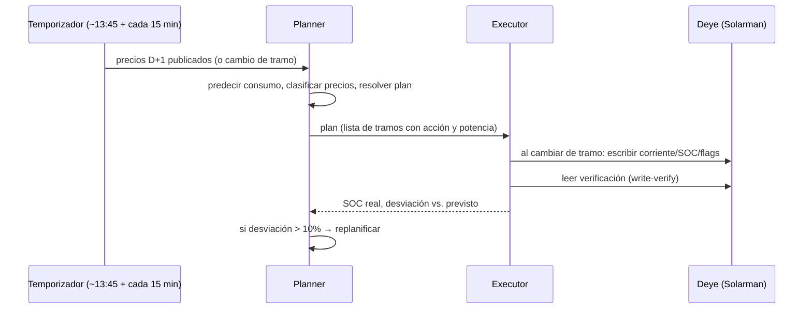
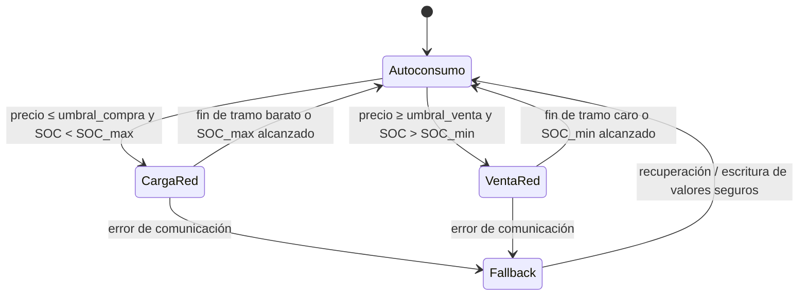

# Diseño y Especificación — `omie_battery_optimizer`

**Custom component de Home Assistant** para optimizar carga/descarga de batería (inversor Deye vía datalogger Solarman) con precios del mercado eléctrico español en tramos de 15 minutos (OMIE) y predicción de consumo del hogar.

> Documento de especificación destinado a ser entregado a **Devstral** como fuente única de verdad para la implementación.

---

> **Estado del documento** (2026-10): F1 completada y en producción doméstica. F2–F6 pendientes. Este documento mantiene la visión completa pero marca explícitamente lo que ya está implementado y lo que es todavía diseño.

---

## 1. Visión general

El componente se ejecuta dentro de Home Assistant y:

1. **F1 ✅** Obtiene los precios del mercado diario OMIE con resolución de 15 minutos (MTU15) **vía los sensores de plantilla** que crea la integración oficial OMIE, con fallback a REData.
2. **F2 🚧** Lee por Solarman (Modbus local) el estado del inversor Deye: SOC, potencias, consumo de casa, producción FV, estado de red.
3. **F3 🚧** Predice el consumo de la casa con un modelo estadístico (F3) o ML (F5).
4. **F5 🚧** Calcula un plan por tramos de 15 min con autoconsumo + arbitraje.
5. **F4 🚧** Aplica el plan escribiendo en el inversor con salvaguardas (dry-run, límite de escrituras, watchdog, fallback).

Prioridad de estrategia: **autoconsumo + arbitraje cuando convenga**.

---

## 2. Contexto del sistema existente

| Elemento | Detalle |
|---|---|
| Plataforma | Home Assistant Yellow (HAOS) |
| Inversor | Deye SUN-6K-SG05LP1-EU-AM2-P — 6.000 W, PV máx. 7.800 W, batería 40–60 V, corriente máx. carga/descarga **0–135 A** |
| Batería | Docan 51,2 V 300 Ah LiFePO4 (15,36 kWh nominales); fabricante recomienda 140 A (máx. 200 A), límite real del inversor 135 A |
| Datalogger | Solarman serie **3178171873**, IP fija **192.168.1.76** |
| Históricos | Node-RED + InfluxDB (producción y consumo), estadísticas de HA |
| **Sensores OMIE** | **Integración oficial OMIE + plantilla `precios_omie.yaml`** (ver §5.1). Sustituye la plantilla RESTful previa `config/plantillas/energia.yaml`. |
| Clima | Integración weather de HA (definir en F3) |
| Tarifa | 2.0TD con **5,75 kW contratados**; peajes y cargos en §5.6 |
| Remuneración excedentes | **Al mismo precio que la compra** (contrato con mayorista) |

---

## 3. Requisitos funcionales

### RF-01 — Precios OMIE a 15 minutos
- **F1 ✅** Obtener precio del mercado diario español (MDA) a **15 min** para hoy y mañana, en €/kWh.
- **F1 ✅** Fuentes en cascada: **sensores de plantilla** `sensor.omie_precios_de_es_{ayer,hoy,manana}` (creados por el usuario con `omie.get_prices_for_date`) → **REData** (`api.preciodelaluz.es`). ESIOS **eliminado** (placeholder); llegará cuando se implemente de verdad.
- **F1 ✅** Caché por día en disco (`cache/YYYY-MM-DD.json`), validada a 96 tramos.
- **F1 ✅** Refresco: coordinador cada 15 min + triggers de la plantilla (13:35 y 00:05) + reinicio HA.
- **F1 ✅** Exponer precio actual, precio efectivo, clasificación por percentiles y estadísticas.

### RF-02 — Telemetría Solarman 🚧 F2
Sin cambios respecto al diseño original: `pysolarmanv5` en executor, polling cada 30 s, `registers.yaml` configurable y validación por `probe_registers`.

### RF-03 — Control de carga/descarga 🚧 F4
Sin cambios. Mapa de registros configurable, write-verify, límite de escrituras por hora.

### RF-04 — Compra/venta con parámetros ajustables 🚧 F4/F5
Sin cambios. Restricción dura: importación total (consumo + carga batería) ≤ **5,75 kW**.

### RF-05 — Predicción de consumo 🚧 F3/F5
Sin cambios.

### RF-06 — Planificador y ejecutor 🚧 F3/F4
Sin cambios.

---

## 4. Arquitectura

Igual que en el diseño original. En F1 solo están activos los módulos:

- `ClienteOmie` (equivalente a `OmieClient`)
- `ModeloTarifa` (equivalente a `TariffModel`)
- `CoordinadorDatosOmie` (equivalente a `Coordinator`)
- Entidades y `config_flow`

Los módulos `Forecaster`, `Planner`, `Executor`, `SolarmanClient` **no existen todavía**.

Diagrama (sin cambios conceptuales):

```mermaid
flowchart TD
  subgraph Fuentes
    OMIE["Integración OMIE + plantilla\n(sensores omie_precios_de_es_*)"]
    REDATA["REData\n(fallback)"]
    SOLAR["Datalogger Solarman\n(F2+)"]
    WEATHER["Clima / calendario\n(F3+)"]
    HIST["Histórico consumo\n(F3+)"]
  end
  subgraph Componente["optimizador_bateria_omie"]
    PRICE["ClienteOmie ✅"]
    TARIFF["ModeloTarifa ✅"]
    TELEM["SolarmanClient 🚧"]
    FORECAST["ConsumptionForecaster 🚧"]
    PLANNER["Planner 🚧"]
    EXECUTOR["Executor 🚧"]
    CONFIG["Config Flow + Entidades ✅"]
    AUDIT["Audit / Stats 🚧"]
  end
  OMIE --> PRICE
  REDATA --> PRICE
  SOLAR --> TELEM
  HIST --> FORECAST
  WEATHER --> FORECAST
  PRICE --> TARIFF
  TARIFF --> PLANNER
  FORECAST --> PLANNER
  TELEM --> PLANNER
  CONFIG --> PLANNER
  PLANNER --> EXECUTOR
  EXECUTOR --> SOLAR
  PLANNER --> AUDIT

--------

## 1. Visión general - original

El componente se ejecuta dentro de Home Assistant y:

1. Obtiene los **precios del mercado diario OMIE con resolución de 15 minutos** (MTU15, operativo en España desde el 1 de octubre de 2025) y, opcionalmente, los refina con precios de tiempo real.
2. Lee por **Solarman (Modbus local)** el estado del inversor Deye: SOC de batería, potencias de carga/descarga, consumo de casa, producción fotovoltaica, estado de red.
3. **Predice el consumo** de la casa con un modelo que usa histórico + calendario (laborable/festivo/vacaciones, hora, día de semana) + clima (temperatura exterior, irradiancia).
4. Calcula un **plan horario por tramos de 15 min** que prioriza el autoconsumo y aplica arbitraje (comprar barato / vender caro) solo cuando es rentable tras aplicar la eficiencia round-trip y los parámetros ajustables del usuario.
5. **Aplica el plan escribiendo** en el inversor (corriente de carga/descarga, límites de SOC, carga desde red, venta a red) con salvaguardas: modo dry-run, límite de escrituras, watchdog y fallback a autoconsumo básico si algo falla.

Prioridad de estrategia (fijada por el usuario): **autoconsumo + arbitraje cuando convenga**.

---

## 2. Contexto del sistema existente

| Elemento | Detalle |
|---|---|
| Plataforma | Home Assistant Yellow (HAOS), en uso desde ~2023 |
| Inversor | **Deye SUN-6K-SG05LP1-EU-AM2-P** — híbrido monofásico, 6.000 W nominales, PV máx. 7.800 W, rango de batería 40–60 V, corriente máx. de carga/descarga configurable **0–135 A** |
| Batería | **Docan 51,2 V 300 Ah LiFePO4** (vertical móvil) — **15,36 kWh nominales**; fabricante recomienda 140 A de carga/descarga (máx. 200 A), pero el límite real lo impone el inversor (135 A ≈ 6,9 kW) |
| Datalogger | Solarman (integración HA existente para telemetría) |
| Históricos | Node-RED + InfluxDB (producción y consumo), estadísticas de HA |
| Sensores OMIE previos | `config/plantillas/energia.yaml` (plantillas RESTful/scrape de OMIE) — **este componente las sustituye** |
| Clima | Integración weather de HA (o servicio elegido por el usuario) |

Supuestos a confirmar en el arranque del proyecto (sección 12): entidad de clima/festivos. El inversor, la batería, el datalogger Solarman (serie **3178171873**, IP fija **192.168.1.76**), la tarifa indexada (peajes y cargos 2.0TD, potencia contratada **5,75 kW**) y la remuneración de excedentes (**venta al mismo precio que la compra**, contrato con mayorista) **ya están confirmados** (tabla superior y §5.6).

---

## 3. Requisitos funcionales

### RF-01 — Precios OMIE a 15 minutos
- Consultar el precio del mercado diario español (MDA) con **resolución de 15 minutos** para hoy y mañana, en €/MWh y €/kWh.
- Fuentes (en orden de preferencia, con fallback automático y registro del origen en atributos):
  1. **API pública OMIE** (`api.omie.es` — mercado diario, precios de cierre por unidad de mercado de 15 min; publicación ~13:30 CET tras la subasta).
  2. **REData/apidatos de Red Eléctrica**: `https://apidatos.ree.es/es/datos/mercados/precios-mercados-tiempo-real?start_date=...&end_date=...&time_trunc=quarter` (precios por tramo).
  3. **ESIOS** (`api.esios.ree.es`, indicadores de precio; requiere token personal — opcional, configurado por el usuario).
- Refresco programado: a las ~13:45 CET diarias (publicación del día D+1) + reintento con backoff; y refresco horario opcional de precios de tiempo real para el tramo en curso.
- Exponer: precio del tramo actual, curva completa de hoy y mañana, estadísticas (mín/máx/mediana, cuantiles), y clasificación (valle/llano/punta por percentiles).

### RF-02 — Telemetría Solarman
- Conexión **local** al datalogger Solarman vía **pysolarmanv5** (TCP, puerto 8899, nº de serie del datalogger) mediante Modbus.
- Lecturas periódicas (por defecto cada 30 s, configurable): SOC batería, tensión/corriente/potencia batería, temperatura; consumo de casa (W y energía acumulada); producción FV; importación/exportación de red; estado del inversor; parámetros actuales de control (corrientes y límites programados).
- Persistencia interna de históricos de consumo a 15 min (para el predictor) en `data_interval_statistics` / SQLite propio, además de lo que ya exista en InfluxDB.

### RF-03 — Control de carga/descarga (parámetros ajustables)
- Servicios para ajustar, en cualquier momento: corriente/potencia de carga, corriente/potencia de descarga, SOC objetivo de carga, SOC mínimo, habilitación de carga desde red, habilitación de venta a red.
- **Mapa de registros configurable en YAML** (el componente no debe hardcodear direcciones): telemetría y control del Deye (ver 5.3). Modo `probe`/calibración que lee un registro, lo compara con el valor mostrado en pantalla/APP y valida antes de permitir escrituras.
- Límite de seguridad: máximo N escrituras por hora (por defecto 12) y verificación de lectura tras escritura (write-verify).

### RF-04 — Compra/venta con parámetros ajustables
- Decisión de **comprar** (cargar batería desde red) cuando el precio proyectado del tramo esté por debajo del umbral ajustable y por debajo del precio medio ponderado al que se espera descargar. El coste de compra se valora con el **precio efectivo** = spot + peajes/cargos del tramo (modelo de tarifa §5.6) + impuestos configurables.
- Decisión de **vender** (verter batería a red más allá del autoconsumo) cuando el precio supere el umbral de venta y compense la eficiencia round-trip (solo si `p_venta ≥ p_compra_efectiva / η_round_trip + margen`). Con el contrato actual la venta se valora **al mismo precio que la compra** (§5.6), de modo que el arbitraje comprar-valle/vender-punta es rentable siempre que `p_punta − p_valle > margen + pérdida por η_round_trip`.
- **Restricción dura de potencia contratada**: la importación total de red (consumo de la casa + carga de batería) nunca superará los **5,75 kW**.
- Todos los umbrales como entidades `number`/`switch` de HA modificables sin reinicios; aplicar cambios recalcula el plan en ≤ 60 s.

### RF-05 — Predicción de consumo
- Predicción de la curva de consumo por tramos de 15 min para el horizonte del plan (hoy + mañana si hay precios).
- Modelo **avanzado** con variables de calendario y clima:
  - Calendario: hora del día, día de semana, festivo nacional/local (lista configurable), periodos vacacionales configurables, mes/estación.
  - Clima: temperatura exterior (media prevista del tramo), irradiancia/previsión solar si está disponible.
  - Histórico: consumo del mismo tramo en los últimos N días (N configurable, por defecto 28), percentiles por tramo×tipo de día.
- Implementación por capas (fallback en cascada):
  1. **Modelo ML** (Gradient Boosting / LightGBM con scikit-learn), reentrenado semanalmente por la noche, con métricas de backtesting (MAPE) expuestas como sensor diagnóstico.
  2. **Perfil estadístico**: mediana del consumo por tramo y tipo de día (laborable/festivo/vacaciones).
  3. **Persistencia**: consumo del mismo día de la semana anterior.
- La predicción incluye banda de incertidumbre (p10–p90) que el planificador puede usar de forma conservadora (decisión de venta solo si es rentable en el percentil p90 de consumo).

### RF-06 — Planificador y ejecutor
- Genera un **plan por tramos de 15 min** con: acción (AUTOCONSUMO / CARGA_RED / VENTA_RED / MANTENER), potencia objetivo, SOC previsto, precio de referencia y beneficio marginal estimado.
- Publica el plan como sensor con atributos JSON y lo expone en un dashboard; guarda un **registro de auditoría** (logbook propio) de cada decisión, plan aplicado, y desviación real vs. previsto (para reentrenar y auditar el ahorro).
- Ejecutor con **modo dry-run** (calcula y publica el plan pero no escribe en el inversor) — obligatorio en la fase inicial de puesta en marcha.
- Recalcula ante: llegada de precios nuevos, cambio de parámetros, desviación > X % entre SOC real y previsto (por defecto 10 %), o fallo de comunicación.

---

## 4. Arquitectura

```mermaid
flowchart TD
  subgraph Fuentes
    OMIE["API OMIE / REData\n(precios 15 min)"]
    SOLAR["Datalogger Solarman\n(Modbus local)"]
    WEATHER["Clima / calendario\n(HA)"]
    HIST["Histórico consumo\n(HA stats / InfluxDB)"]
  end
  subgraph Componente["omie_battery_optimizer (custom component HA)"]
    PRICE["OmieClient\n(precios + cuantiles)"]
    TARIFF["TariffModel\n(peajes + cargos)"]
    TELEM["SolarmanClient\n(telemetría + control)"]
    FORECAST["ConsumptionForecaster\n(ML + fallback)"]
    PLANNER["Planner\n(plan 15 min)"]
    EXECUTOR["Executor\n(escritura segura)"]
    CONFIG["Config Flow + Entidades\n(number/switch/sensor)"]
    AUDIT["Audit / Stats\n(ahorro, MAPE, log)"]
  end
  OMIE --> PRICE
  SOLAR --> TELEM
  HIST --> FORECAST
  WEATHER --> FORECAST
  PRICE --> TARIFF
  TARIFF --> PLANNER
  FORECAST --> PLANNER
  TELEM --> PLANNER
  CONFIG --> PLANNER
  PLANNER --> EXECUTOR
  EXECUTOR --> SOLAR
  PLANNER --> AUDIT
  TELEM --> AUDIT
  CONFIG --> EXECUTOR
  TARIFF --> EXECUTOR
```

Ciclo del planificador:



Máquina de estados del modo de la batería (por tramo):



---

## 5. Módulos del componente

### 5.1 `OmieClient`
- `async def get_day_ahead(fecha) -> list[Slot]` con `Slot = {datetime_utc, precio_eur_kwh, fuente, ts_publicacion}`.
- Cacheo en disco (JSON por fecha) para sobrevivir a fallos de red; TTL y reintentos con backoff exponencial; timeout 10 s.
- Añadidos de coste configurables para aproximar el precio efectivo de una tarifa indexada: gestionados por el `TariffModel` (§5.6, peajes y cargos por periodo).
- Normaliza a tramos de 15 min (96/día, cambio de hora incluido: 92/100 tramos en días de transición).

### 5.2 `SolarmanClient`
- Wrapper sobre **pysolarmanv5**: `PySolarmanV5(ip, serial, port=8899, verbose=False)` con `read_holding_registers(addr, qty)` y `write_multiple_holding_registers(addr, values)`.
- Polling asíncrono con `asyncio` (pysolarmanv5 es bloqueante → ejecutar en `executor`), reconexión automática, y semáforo para serializar escrituras.
- **Modo solo-lectura opcional**: si el usuario prefiere, la telemetría puede consumirse de las entidades de la integración Solarman ya instalada (via `hass.states`), reservando la conexión Modbus propia únicamente para escrituras de control. Esto evita doble polling; será una opción del config flow (`telemetry_source: solarman_modbus | ha_entities`).

### 5.3 Mapa de registros Deye (configurable, validar antes de operar)

⚠️ **El SUN-6K-SG05LP1-EU-AM2-P monta placa de la generación "AM2"**, cuya dirección de registros difiere de las generaciones anteriores. La comunidad documenta dos familias candidatas; el componente debe arrancar en modo `probe` (lectura y comparación con pantalla/APP) y **solo habilitar escrituras tras validar la familia correcta**:

| Función | Familia A (placas nuevas SG04LP3/AM2/HP3) | Familia B (placas clásicas SG01/03LP1) |
|---|---|---|
| SOC / potencia batería | 586–591 (588 SOC, 590 potencia ±, 591 corriente) | 4210–4233 aprox. |
| Corriente de carga objetivo | 128 (A, 0–135 para 6 kW) | dentro del bloque TOU |
| Flags de control (carga red, SOC límites) | 108, 130, 166, 172 | 4341 y afines |
| Time-of-Use (slots) | direcciones propias de la placa, hasta 6 slots | 4310–4312 (habilitación), 4315–4338 (6 programas: hora inicio, fin, A carga, A descarga) |

Fuentes comunitarias señalan además que en lecturas Modbus sobre dataloggers de esta generación conviene limitar las peticiones a bloques ≤ 16 registros para evitar timeouts.

Estructura del archivo `registers.yaml` (esquema exigido a Devstral):

```yaml
inverter: "deye-sun-6k-sg05lp1-am2"   # perfil del equipo confirmado
telemetry:
  soc:      { addr: 588, scale: 0.1, unit: "%" }        # familia A (validar con probe)
  bat_power:{ addr: 590, scale: 1,   unit: "W", signed: true }   # + descarga, − carga
  load_power:{ addr: 670, scale: 0.1, unit: "W" }
  pv_power: { addr: 633, scale: 0.1, unit: "W" }
control:
  charge_current_a: { addr: 128, min: 0, max: 135 }     # límite del SUN-6K (0–135 A)
  charge_from_grid: { addr: 166, write: [0, 1] }
  soc_charge_limit: { addr: 172, scale: 1, min: 10, max: 100 }
  soc_discharge_limit: { addr: 108, scale: 1, min: 10, max: 100 }
tou_slots: # opcional: si se prefiere programar slots del inversor en vez de escribir cada tramo
  enabled: true
  max_slots: 6
  block_size: 16   # no solicitar más de 16 registros por lectura (timeouts del datalogger)
```

*(Las direcciones anteriores son punto de partida del perfil: Devstral debe tratarlas como configuración, nunca como constantes de código. El servicio `probe_registers` valida la familia A/B y el HMI antes de habilitar escrituras.)*

### 5.4 `ConsumptionForecaster`
- Entrenamiento nocturno (semanal) sobre el histórico de consumo a 15 min con features: `tramo_dia (0-95)`, `dia_semana`, `es_festivo`, `es_vacaciones`, `temperatura_media_prevista`, `irradiancia_prevista`, `consumo_mismo_tramo_7d_14d_21d_28d`.
- Salida: `prediccion[tramo] = {p50, p10, p90}` en W.
- Backtesting walk-forward con métricas (MAPE, sesgo) → sensor `sensor.omb_consume_forecast_quality`.
- Reentrenamiento bajo `job` de HA; el modelo se guarda en el directorio de datos de la integración (`.pkl` o ONNX, sin dependencias pesadas: scikit-learn está permitido; excluir torch/tensorflow).

### 5.5 `Planner`
- Entrada: precios (96–192 tramos), predicción consumo (p50/p90), predicción FV si existe, estado batería, parámetros.
- Estrategia en dos capas:
  1. **Autoconsumo siempre**: la batería absorbe `consumo − FV` cuando `SOC > soc_min` (respetando potencia de descarga); nunca carga batería desde red por debajo de `soc_min` salvo decisión de arbitraje.
  2. **Arbitraje**: en tramos con precio bajo, carga desde red hasta `soc_max` si el coste esperado del ciclo completo (comprar ahora + cubrir consumo que de otro modo se compraría más caro, o vender después) supera un margen ajustable. En tramos caros, descarga adicional a red hasta `soc_min` solo si el precio neto de venta lo justifica.
- Implementación: **programación lineal entera mixta** con PuLP/SciPy (variables: energía comprada/vendida/almacenada por tramo, con balance SOC por tramo y restricciones de potencia, de SOC y de **potencia contratada ≤ 5,75 kW**, §5.6). Alternativa greedy documentada como fallback para el MVP. La LP es pequeña (≈192 variables × 4) y resuelve en <1 s.
- El plan incluye `coste_sin_plan` (todo a precio de compra por tramo) vs. `coste_con_plan` → **ahorro estimado del día**, expuesto como sensor.

### 5.6 `TariffModel` (peajes y cargos de la tarifa indexada 2.0TD)

Tarifa con **potencia contratada de 5,75 kW** (dos periodos de potencia, tres de energía):

**Cargos por potencia** (coste fijo por kW contratado; **no afecta a las decisiones del plan**, se incluye solo en los informes de coste):
| Periodo | Franja | Peaje €/kW·día | Cargo €/kW·día |
|---|---|---|---|
| P1 | L–V 08:00–24:00 | 0,063904 | 0,011999 |
| P2 | L–V 00:00–08:00, S–D y festivos | 0,001216 | 0,000772 (×30 días/mes) |

**Cargos por energía** (se suman al spot para el precio efectivo de compra):
| Periodo | Días | Horas | Peaje €/kWh | Cargo €/kWh | **Total €/kWh** |
|---|---|---|---|---|---|
| Punta | L–V | 10:00–14:00 y 18:00–22:00 | 0,033261 | 0,064292 | **0,097553** |
| Llano | L–V | 08:00–10:00, 14:00–18:00 y 22:00–24:00 | 0,016409 | 0,012858 | **0,029267** |
| Valle | L–V | 00:00–08:00 | 0,000077 | 0,003215 | **0,003292** |
| Valle | S–D y festivos nacionales | 00:00–24:00 | 0,000077 | 0,003215 | **0,003292** |

- `precio_compra_efectivo(tramo) = (spot_15min + total_periodo) × (1 + impuesto_eléctrico) × (1 + IVA)`; impuestos configurables (por defecto 5,1127 % y 21 %) y desactivables.
- La **venta de excedentes** se valora **al mismo precio que la compra** del tramo (contrato con mayorista: `valorar_venta_como_compra: true` por defecto). Modo alternativo configurable `precio_venta_factor × spot` por si el contrato cambia. Con valoración simétrica, el arbitraje puro es rentable si `p_punta − p_valle > margen + pérdida por η_round_trip`.
- **Restricción de potencia contratada**: importación total (consumo casa + carga de batería) ≤ **5,75 kW** en todo momento. El planificador limita la potencia de carga de la batería a `5,75 kW − consumo previsto del tramo − margen` (margen por defecto 0,3 kW).
- El Executor añade un **guard dinámico**: si la importación medida supera el 95 % de la potencia contratada, reduce la corriente de carga de la batería.
- Los festivos nacionales usan la franja de valle completa — reutiliza la lista configurable `festivos` del predictor.

---

## 6. Entidades y servicios de Home Assistant

### Entidades

| Entidad | Tipo | Descripción |
|---|---|---|
| `sensor.omb_precio_actual` | sensor (€/kWh) | precio del tramo en curso + atributo `curva_hoy`, `curva_mañana` |
| `sensor.omb_precio_efectivo` | sensor (€/kWh) | precio efectivo de compra: spot + peajes/cargos del tramo + impuestos |
| `sensor.omb_precio_clasificacion` | sensor | valle/llano/punta por percentiles del día |
| `sensor.omb_prediccion_consumo` | sensor | W previstos del tramo actual; atributo: curva p10/p50/p90 |
| `sensor.omb_plan` | sensor | acción y potencia del tramo actual; atributos: plan completo (JSON), ahorro estimado, fuente precios, estado |
| `sensor.omb_ahorro_hoy` | sensor | € ahorrados acumulados hoy (real, desde auditoría) |
| `sensor.omb_forecast_quality` | diagnostic | MAPE del último backtest |
| `switch.omb_activo` | switch | habilita/deshabilita la escritura (dry-run cuando off) |
| `switch.omb_permitir_carga_red` | switch | arbitraje de compra |
| `switch.omb_permitir_venta_red` | switch | arbitraje de venta |
| `switch.omb_festivo_hoy` | switch | marca manual de festivo/vacaciones |
| `number.omb_precio_max_compra` | number (€/kWh) | umbral por debajo del cual se puede comprar |
| `number.omb_precio_min_venta` | number (€/kWh) | umbral por encima del cual se puede vender |
| `number.omb_margen_arbitraje` | number (€/kWh) | margen mínimo de beneficio del ciclo |
| `number.omb_soc_min` / `omb_soc_max` | number (%) | límites operativos |
| `number.omb_potencia_max_carga` / `descarga` | number (W) | límites de potencia |
| `number.omb_potencia_max_red` | number (W) | potencia contratada / límite de importación (defecto 5.750) |
| `number.omb_eficiencia_round_trip` | number (%) | 70–95 |

### Servicios

```yaml
# Regenerar plan ya (tras cambiar parámetros)
omie_battery_optimizer.regenerate_plan: {}
# Aplicar manualmente un modo hasta una hora dada
omie_battery_optimizer.force_mode:
  mode: carga_red | venta_red | autoconsumo | apagado
  until: "23:00"
# Volver al plan automático
omie_battery_optimizer.release_manual: {}
# Calibración/validación del mapa de registros (fase 2)
omie_battery_optimizer.probe_registers:
  register: 588
  expected: 73          # valor que muestra pantalla/APP
```

---

## 7. Parámetros ajustables (resumen de esquema de config)

```yaml
omie_battery_optimizer:
  omie:
    source: omie            # omie | apidatos | esios
    esios_token: null
    valorar_venta_como_compra: true   # venta al mismo precio que la compra (contrato con mayorista)
    precio_venta_factor: 1.0          # solo se usa si valorar_venta_como_compra: false
  tarifa:
    potencia_contratada_kw: 5.75       # límite de importación (consumo + carga batería)
    margen_potencia_w: 300             # margen de seguridad bajo la potencia contratada
    impuesto_electrico_pct: 5.1127
    iva_pct: 21
    aplicar_impuestos_precio: true     # precio efectivo con impuestos
    energia:                          # peaje + cargo se suman al spot (§5.6)
      punta: { dias: laborables, horas: ["10:00-14:00", "18:00-22:00"], peaje: 0.033261, cargo: 0.064292 }
      llano: { dias: laborables, horas: ["08:00-10:00", "14:00-18:00", "22:00-24:00"], peaje: 0.016409, cargo: 0.012858 }
      valle:  { horas: ["00:00-08:00"], peaje: 0.000077, cargo: 0.003215 }   # S-D y festivos: valle todo el día
    potencia:                          # coste fijo (solo informes)
      p1: { dias: laborables, horas: "08:00-24:00", peaje_kw_dia: 0.063904, cargo_kw_dia: 0.011999 }
      p2: { peaje_kw_dia: 0.001216, cargo_kw_mes: 0.000772 }
  solarman:
    ip: 192.168.1.76
    port: 8899
    serial: 3178171873
    telemetry_source: solarman_modbus   # o ha_entities
    register_profile: deye-sun-6k-sg05lp1-am2
  battery:
    capacidad_kwh: 15.36
    voltaje_nominal: 51.2
    corriente_max_a: 135        # límite del inversor; BMS Docan recomienda 140 A
    soc_min: 15
    soc_max: 95
    potencia_max_carga_w: 5000    # ≈ 98 A: margen bajo el límite de 135 A
    potencia_max_descarga_w: 5000
    eficiencia_round_trip: 88
  strategy:
    permitir_carga_red: true
    permitir_venta_red: true
    precio_max_compra: 0.09
    precio_min_venta: 0.18
    margen_arbitraje: 0.015
  forecast:
    ventana_historico_dias: 28
    usar_clima: true
    weather_entity: weather.casa
    festivos: ["01-01", "06-01", "12-10", "01-11", "06-12", "25-12"]
    vacaciones_rangos: [["2026-07-01", "2026-08-31"]]
  seguridad:
    dry_run: true          # OBLIGATORIO true hasta validar registros
    max_escrituras_por_hora: 12
    desviacion_soc_replan_pct: 10
```

Todos los valores de `strategy`, `battery` y `seguridad.dry_run` se exponen como entidades modificables en caliente (config flow + `options`).

---

## 8. Fases de implementación (roadmap para Devstral)

| Fase | Alcance | Criterio de salida |
|---|---|---|
| **F1 — Precios** | `OmieClient` + `TariffModel` (precio efectivo con peajes/cargos, §5.6) + sensores de precio + atributos de curva; dashboard básico | Precio del tramo y precio efectivo coinciden con OMIE + facturación esperada durante 3 días seguidos |
| **F2 — Solarman** | `SolarmanClient` (Modbus local) + `registers.yaml` + servicio `probe_registers`; telemetría en HA | SOC y potencias coinciden con la APP Solarman; mapa de registros validado |
| **F3 — Predicción v1 + Planificador greedy** | Forecaster estadístico (perfil por tramo×tipo de día) + planner greedy en dry-run; sensor plan + ahorro estimado | Plan diario plausible revisado manualmente 1 semana en dry-run |
| **F4 — Control** | Executor con write-verify, límite de escrituras, fallback y watchdog; activación real gradual (solo carga desde red en valle nocturno) | 1 semana sin errores; verificación de escrituras en inversor |
| **F5 — ML + LP** | Forecaster ML (calendario+clima), optimización LP, banda p90, auditoría de ahorro real, reentrenamiento semanal | MAPE de backtest < 20 % en tramas de alto consumo; ahorro real medible |
| **F6 — Pulido** | Dashboard Lovelace completo, notificaciones de decisiones relevantes, exportación de informes mensuales | Uso continuado 30 días sin intervención |

---

## 9. Seguridad y resiliencia (no negociable)

- `dry_run` por defecto `true`: el plan se publica pero nunca escribe hasta validación explícita del usuario.
- Write-verify: tras cada escritura, relectura del registro; a los 3 fallos consecutivos → estado `fallback` (reestablecer modo autoconsumo nativo del inversor) y deshabilitar escrituras hasta intervención.
- Nunca permitir: SOC objetivo < límite de descarga del inversor, corrientes > límites del `registers.yaml`, escrituras cuando el inversor reporte alarma/fault.
- Guard de potencia contratada: la importación medida (consumo + carga batería) nunca debe superar **5,75 kW**; si supera el 95 %, el Executor reduce la corriente de carga de la batería.
- Si no hay precios para el día siguiente → plan solo con lo disponible; si tampoco hay datos hoy → mantener autoconsumo (no inventar planes).
- Auditoría inmutable (JSONL en directorio de datos) de: cada plan, cada escritura, cada error.

---

## 10. Pruebas exigidas (CI)

- `pytest` con mocks de las APIs (fixtures de JSON de OMIE/apidatos, incluyendo día con 92/100 tramos por cambio horario).
- Simulador del inversor: clase fake que implementa el mapa de registros para probar el executor sin hardware.
- Tests del planner con escenarios: día valle/punta clásico, precio negativo, rampa de precios, SOC inicial 0/50/100, venta deshabilitada.
- Tests del forecaster con dataset sintético + backtesting reproducible (seed fija).
- Lint: `ruff` + `homeassistant` package constraints (HA 2025.x, Python ≥ 3.13).

---

## 11. Estructura del repositorio

```
omie-battery-optimizer/
├── custom_components/omie_battery_optimizer/
│   ├── manifest.json
│   ├── config_flow.py
│   ├── const.py
│   ├── coordinator.py          # DataUpdateCoordinator central
│   ├── omie_client.py
│   ├── solarman_client.py
│   ├── registers.yaml
│   ├── forecaster.py           # estadístico + ML
│   ├── planner.py              # greedy + LP
│   ├── executor.py             # escritura segura + watchdog
│   ├── entities.py             # sensores/switch/number
│   ├── services.yaml
│   ├── translations/es.json
│   └── tests/
├── hacs.json
├── README.md
└── docs/INSTALACION.md
```

---

## 12. Datos pendientes de confirmar antes de la fase 2

Ya confirmados: **inversor Deye SUN-6K-SG05LP1-EU-AM2-P**, **batería Docan 51,2 V 300 Ah (15,36 kWh)**, **datalogger Solarman** (serie `3178171873`, IP fija `192.168.1.76`), **tarifa indexada 2.0TD con 5,75 kW contratados** (peajes y cargos en §5.6) y **remuneración de excedentes: al mismo precio que la compra** (contrato con mayorista). Quedan por confirmar:

1. Entidad de clima de HA a usar y lista de festivos locales.
2. Si existe previsión de producción FV (Solcast u otro) — opcional, mejora el plan.
3. Resultado del `probe_registers`: familia de registros A/B válida para la placa AM2 (bloquea la fase de control).

---

## 13. Fuentes y referencias

- OMIE, nota de prensa *go-live MTU15 en el mercado diario* (1 de octubre de 2025) y página de precios del mercado diario por periodo (H1Q1…): https://www.omie.es
- Red Eléctrica — REData API (`apidatos.ree.es/es/datos/mercados/precios-mercados-tiempo-real`) y ESIOS (`api.esios.ree.es`).
- pysolarmanv5 (librería de referencia para dataloggers Solarman en local): https://pysolarmanv5.readthedocs.io
- Datasheet Deye SUN-6K-SG05LP1-EU (6.000 W, PV 7.800 W, carga/descarga 0–135 A en modelo 6 kW, batería 40–60 V).
- Docan Power, pack LiFePO4 51,2 V 280–300 Ah: corriente recomendada 140 A, máx. 200 A.
- Foros y guías comunitarias de registros Modbus Deye (varían por modelo/generación — validar siempre con el manual del propio equipo).
